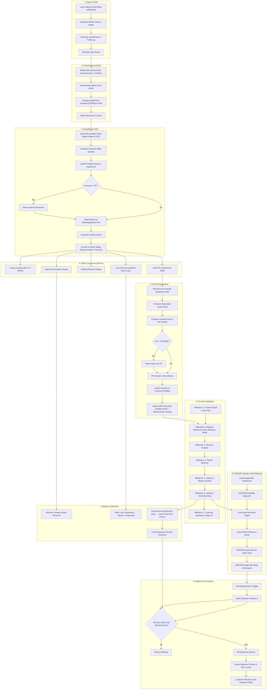

# Solaris EPC – Solar ERP System (Phase 1)
## Document 04: Complete End-to-End Workflow & Process Architecture

---

### 1. Process Overview & Operational Philosophy
The Solaris EPC lifecycle connects sales, engineering, supply chain, regulatory liaisoning, and accounting across a unified operational thread. Every activity is anchored to a unique **`Project ID`** generated at order conversion.

The workflow operates across **four parallel, interconnected lanes**:
1. **Sales & Delivery Lane:** Customer acquisition, engineering survey, BOM design, quotation, project milestones, and physical handover.
2. **Supply & Payables Lane:** BOM-driven requisition, competitive RFQ, direct-to-site PO, mobile site GRN with serial number capture, and 3-way matched bill payments.
3. **Subsidy & DISCOM Lane:** PM Surya Ghar portal filings, DISCOM feasibility, Work Completion Report (WCR), DISCOM Service Order (SO), and physical net-metering energization.
4. **Customer Payments Lane:** Margin money, bank loan sanction, Tranche 1 disbursement, milestone delivery payments, final commissioning settlement, and post-net-metering Tranche 2 disbursement.

---

### 2. Comprehensive 13-Stage End-to-End Numbered Process Steps

```
[Lead Capture & Qualification] 
              ↓
    [Site Survey on Mobile] 
              ↓
  [System Design & BOM Build] 
              ↓
  [Quotation & Subsidy Pricing] 
              ↓
[Quote Acceptance & Order Conversion] 
              ↓
 [Concurrent Tracks: Subsidy + Procurement + Payments] 
              ↓
   [Direct-to-Site Material Receipt (GRN)] 
              ↓
   [Sequential Installation Milestones (1-5)] 
              ↓
  [Testing, Commissioning & Handover (6-7)] 
              ↓
    [Final GST Invoice & Commissioning Dues] 
              ↓
 [DISCOM WCR → Service Order → Net Metering] 
              ↓
[Bank Tranche 2 & Complete Dues Clearance] 
              ↓
  [Owner Project Closure & P&L Locking] 
              ↓
 [Customer Subsidy Direct Bank Credit Tracking]
```

---

#### Step 1: Lead Capture & Qualification
1. Lead captured via Walk-in, Referral, Meta Ads, Google Ads, IndiaMART, Website, or Channel Partner.
2. System performs an immediate duplicate check against the 10-digit mobile number. If a duplicate exists, a warning is raised (Admin can merge).
3. Lead is assigned to a Sales Executive. A mandatory follow-up date is set.
4. Sales Executive contacts the prospect, captures monthly electricity bill (₹), sanctioned load (kW), DISCOM, and roof type.
5. Lead transitions: `New` → `Contacted` → `Survey Scheduled`.

#### Step 2: Mobile Site Survey & Technical Feasibility
1. Survey Engineer receives an automated in-app/WhatsApp notification and views the task under mobile "My Surveys".
2. Engineer visits the rooftop site (form operates offline if network is unstable).
3. System auto-captures GPS coordinates. Engineer records usable roof area (sq ft), height/floors, shading conditions (None/Partial/Heavy), orientation, structure type, connection phase (single/three), cable run lengths (m), and inverter location.
4. Engineer captures minimum 4 mandatory photographs: (1) Roof layout, (2) Electricity meter, (3) Distribution Board (DB), (4) Inverter mounting wall.
5. Engineer captures customer digital signature on glass and submits the survey. Status becomes `Completed`.

#### Step 3: System Design & Bill of Materials (BOM)
1. System algorithm suggests recommended system capacity (kWp) from average monthly kWh units; engineer verifies/overrides.
2. System type is selected: `On-grid`, `Hybrid`, or `Off-grid`. Panel type selected: `DCR` (Domestic Content Requirement) or `Non-DCR`. (DCR is mandatory for PM Surya Ghar subsidy eligibility).
3. Engineer loads an admin-managed BOM Template (e.g., "3 kW On-grid DCR").
4. Items (panels, inverter, structure iron, AC/DC cables, ACDB/DCDB, earthing kit, lightning arrestor, MC4 connectors, net meter, labor, transport) scale dynamically based on kWp.
5. Saving the approved BOM locks the design. Lead transitions to `Quote Sent` once a quote is generated.

#### Step 4: Quotation Building, Subsidy Computation & Approvals
1. Sales Executive initiates Quotation Builder from approved BOM. Line rates and GST % pull from Item Master.
2. Subsidy engine computes financial entitlement:
   $$\text{Total Subsidy} = \text{Central Subsidy Slab} + \text{State Subsidy Rule (per kW with Cap)}$$
   $$\text{Net Customer Cost} = \text{Grand Total} - \text{Total Subsidy} \quad (\text{Must be } \ge 0)$$
3. Sales Executive structures payment instalments (no fixed split): defines instalment names, payer (`Customer` or `Bank`), amounts (₹ or %), and triggers. Sum of instalments must exactly equal Grand Total.
4. If a commercial discount is entered and exceeds the configurable limit (default >5% of Grand Total), quote status moves to `Pending Approval`.
5. Owner reviews and approves discount in-app. Quote transitions to `Sent`. PDF shared to customer via WhatsApp/Email.

#### Step 5: Quotation Acceptance & Atomic Order Conversion
1. Customer accepts the proposal. Sales Executive clicks "Convert to Order".
2. System opens the mandatory Conversion Dialog requesting:
   - Payment Mode: `Self-funded`, `Bank loan`, or `Loan + margin money`.
   - Financier and expected loan amount (if loan mode).
   - Advance received now (optional initial collection).
   - Target installation completion date.
3. System atomically generates:
   - Official **Project ID** (`PRJ-YY-NNNN`).
   - Project Payment Schedule containing defined quotation instalments.
   - Government Subsidy Tracking record (pre-populated with expected subsidy).
   - Bank Loan tracking record (if bank loan mode selected).
   - Purchase Requisition (PR) draft (`PR-YY-NNNN`) derived from BOM quantities minus existing assigned leftovers.
4. Lead status updates automatically to `Won`. Accepted quotation is permanently locked.

#### Step 6: Concurrent Track Initiation
Upon order conversion, three functional tracks execute concurrently:
- **Track 6A (Subsidy & DISCOM):** Liaison officer registers application on the National PM Surya Ghar portal (Stage 1) and applies for DISCOM Feasibility (Stage 2).
- **Track 6B (Supply & Procurement):** Project Manager submits PR. Purchase Officer floats RFQ, compares multi-vendor landed costs, and issues PO (`PO-YY-NNNN`) with direct-to-site shipping address. (PO > ₹2,00,000 routes for Owner approval).
- **Track 6C (Customer Financials & Loans):** 
  - If self-funded: Customer pays advance instalment.
  - If bank loan: Customer pays margin money advance. Loan application is submitted to financier; upon sanction, Bank Tranche 1 is disbursed.

#### Step 7: Direct-to-Site Material Receipt (GRN) & Serial Validation
1. Vendor delivers physical materials directly to the customer's rooftop address (no warehouse).
2. Project Manager / Site Installer inspects delivery on mobile.
3. User creates Goods Receipt Note (`GRN-YY-NNNN`), enters vendor challan/invoice number & date, and uploads a photograph of the physical delivery challan.
4. For serialized items (Panels, Inverters, Batteries), serial numbers are captured via barcode camera scan or bulk paste.
5. System enforces global uniqueness: if any serial number exists in another project, submission is blocked.
6. Submitting GRN updates site inventory and unlocks the installation milestone track.

#### Step 8: Sequential Installation Milestones Execution
Site installation proceeds through strictly enforced sequential milestones:
1. *Milestone 1:* Project kickoff and site plan.
2. *Milestone 2:* Material received at site. (**BLOCKING RULE:** Requires at least one GRN on the project).
3. *Milestone 3:* Structure installed (pre-fabricated iron assembled on roof).
4. *Milestone 4:* Panels mounted. (**BLOCKING RULE:** Milestone 3 must be Done).
5. *Milestone 5:* Inverter and wiring complete. (**BLOCKING RULE:** Milestone 4 must be Done).
*(Note: To mark any milestone Done, proof photos and remarks are mandatory. Milestones cannot complete out of order without a logged Owner override).*

#### Step 9: Testing, Commissioning & Customer Handover
1. Project Manager conducts testing and commissioning (*Milestone 6*).
2. PM completes customer handover (*Milestone 7*) with warranty documentation and customer sign-off.
3. **SYSTEM TRIGGER:** Marking "Testing and commissioning" Done:
   - Sets official Project Commissioning Date.
   - Unlocks the `WCR Submitted` stage in the Subsidy module.
   - Triggers the Commissioning Payment instalment as `Due`.

#### Step 10: Final GST Tax Invoice & Commissioning Payment Clearance
1. Accounts Officer generates the official, single final GST Tax Invoice (`INV/26-27/NNNN`).
2. Invoice reflects single lump-sum system value with applicable GST, listing all supplied serial numbers (panels, inverter, battery) from GRNs without per-item pricing.
3. Customer settles the commissioning payment instalment. Accounts logs payment receipt (`RCT-YY-NNNN`).

#### Step 11: DISCOM WCR, Service Order & Net Metering
1. Liaison Officer uploads installation photos and technical completion details to the portal.
2. Liaison Officer submits Work Completion Report (WCR) document (Stage 4). (**BLOCKING RULE:** Requires commissioning milestone Done).
3. DISCOM inspects installation and issues official Service Order (SO) (Stage 5). (**BLOCKING RULE:** Requires WCR submitted).
4. DISCOM meter testing team visits site and installs bidirectional net meter (Stage 6). Liaison records net meter number and energization date.
5. **SYSTEM TRIGGER:** Net Metering Done:
   - Unlocks Bank Loan Tranche 2 status from "Waiting for WCR / SO" to `Due`.
   - Satisfies the regulatory prerequisite for final Project Closure.

#### Step 12: Bank Tranche 2 Disbursement & Complete Financial Settlement
1. Accounts Officer claims Bank Tranche 2 from the financier by submitting net-metering proof.
2. Bank disburses Tranche 2 funds via NEFT/RTGS directly into the company's bank account.
3. Accounts logs bank disbursement against the Tranche 2 instalment.
4. Total Received equals Grand Total; Outstanding Balance reaches ₹0.00.

#### Step 13: Owner Project Closure & P&L Locking
1. Project Manager verifies site completion and clicks "Request Project Closure".
2. System evaluates Closure Prerequisites:
   - Prerequisite 1: All customer and bank instalments must be in `Paid` status (Outstanding = ₹0.00).
   - Prerequisite 2: Subsidy record must be in `Net Metering Done` (or `Not Applicable`).
3. If both conditions are met, Owner approves closure. Status transitions to `Closed`.
4. Project P&L (Revenue − Materials at PO rate − Labor − Freight − Liaison − Other) is permanently frozen and locked.

#### Post-Closure Step: Customer Subsidy Credit
1. Central / State government disburses subsidy directly into the customer's personal bank account.
2. Customer confirms receipt and shares bank statement screenshot / SMS.
3. Liaison Officer logs credit date, amount, and proof in the closed project. Customer drops off the "Pending Subsidy Credit" follow-up list.
4. *(Note: Company receivables are completely unaffected, as subsidy is not company revenue).*

---

### 3. Master End-to-End Mermaid Process Flowchart



---

### 4. Cross-Module Dependency Matrix

| Dependent Module | Triggering / Source Module | Dependency Description | Blocking Severity |
| :--- | :--- | :--- | :--- |
| **Site Survey** | Leads (CRM) | Survey requires valid scheduled date, time, and assigned engineer from an active lead. | Hard Block |
| **BOM Design** | Site Survey | BOM generation requires usable roof area, system type, and monthly consumption data. | Hard Block |
| **Quotation** | BOM Design | Quotation lines and technical sizing pull directly from the approved BOM. | Hard Block |
| **Project Creation** | Quotations | Project ID is generated only upon quotation acceptance via the Convert to Order dialog. | Hard Block |
| **Purchase Requisition** | BOM Design | PR line items auto-populate from BOM quantities minus existing assigned leftovers. | Hard Block |
| **Purchase Order** | PR / RFQ | PO is generated from winning vendor RFQ; requires Owner approval if >₹2,00,000. | Hard Block |
| **Milestone 2 (Material Recd)**| GRN (Procurement) | Milestone 2 cannot be marked Done unless at least one valid GRN exists on the project. | Hard Block |
| **Milestone 4 (Panels Mounted)**| Milestone 3 (Structure) | Panels cannot be mounted unless structure installation is marked Done. | Hard Block (Admin Override logged) |
| **Subsidy WCR Submission** | Milestone 6 (Commissioning)| WCR upload is locked until project testing & commissioning milestone is Done. | Hard Block |
| **DISCOM Service Order (SO)** | Subsidy WCR | DISCOM SO number and date cannot be entered until WCR has been submitted. | Hard Block |
| **DISCOM Net Metering** | DISCOM Service Order (SO) | Net metering installation cannot be recorded until DISCOM SO has been issued. | Hard Block |
| **Bank Loan Tranche 2** | DISCOM Net Metering | Bank Tranche 2 remains "Waiting for WCR/SO" until Net Metering is recorded Done. | Hard Block |
| **Final GST Tax Invoice** | Milestone 6 (Commissioning)| Final invoice generated upon commissioning, pulling serial numbers from GRNs. | Operational Gating |
| **Vendor Bill Payment** | GRN & PO (3-Way Match) | Vendor bill approved for payment only if Bill Qty ≤ GRN Qty and Bill Rate = PO Rate. | Hard Block (Owner approval on mismatch) |
| **Project Closure** | Customer Payments & Subsidy| Closure blocked unless Outstanding Balance is ₹0.00 AND Net Metering is Done. | Hard Block |

---

### 5. Detailed Conditions that Block the Next Step

1. **Quotation Save Block:**
   - *Condition:* If $\text{Grand Total} - \text{Total Subsidy} < 0$, system blocks saving.
   - *Condition:* If sum of payment instalments $\ne \text{Grand Total}$, system blocks saving.
2. **Quotation Dispatch Block:**
   - *Condition:* If quotation discount > 5% (configurable), system blocks sending quote via WhatsApp/Email until Owner approval is granted.
3. **PO Dispatch Block:**
   - *Condition:* If total PO value > ₹2,00,000 (configurable), system blocks issuing PO to vendor until Owner approves.
4. **PO Cancellation Block:**
   - *Condition:* If at least one GRN has been recorded against a PO, cancellation is permanently blocked.
5. **GRN Submission Block:**
   - *Condition:* Missing mandatory challan photograph blocks GRN submission.
   - *Condition:* Serial numbers count not matching received quantity for serialized items (panels, inverters, batteries) blocks GRN submission.
   - *Condition:* Any duplicate serial number that already exists in another project blocks GRN submission.
6. **Milestone Progression Block:**
   - *Condition:* Milestone cannot be marked Done if an earlier milestone is Pending (unless overridden by Admin with logged justification).
   - *Condition:* Milestone 2 ("Material received at site") cannot be marked Done without at least one GRN.
   - *Condition:* Missing proof photographs blocks marking any milestone Done.
7. **Subsidy Stage Progression Block:**
   - *Condition:* WCR submission is blocked if Project Milestone 6 ("Testing and commissioning") is not Done.
   - *Condition:* Service Order (SO) entry is blocked if WCR submission is not completed.
   - *Condition:* Net Metering Done is blocked if Service Order (SO) is not issued.
8. **Bank Tranche 2 Claim Block:**
   - *Condition:* Claiming Bank Tranche 2 is blocked while subsidy stage is prior to Net Metering Done.
9. **Vendor Bill Approval Block:**
   - *Condition:* If Billed Quantity > GRN Quantity or Billed Rate $\ne$ PO Rate, automatic approval is blocked; requires explicit Owner sign-off.
10. **Project Deletion / Cancellation Block:**
    - *Condition:* Deleting a lead with an active project is permanently blocked.
    - *Condition:* Deleting a project with financial or material transactions is permanently blocked.
    - *Condition:* Cancelling a project after physical materials have been received at site is permanently blocked.
11. **Project Closure Block:**
    - *Condition:* Outstanding Customer/Bank balance > ₹0.00 blocks closure.
    - *Condition:* Subsidy status $\ne$ `Net Metering Done` (unless marked `Not Applicable`) blocks closure.
    - *Condition:* Non-Owner users attempting closure are blocked (only Owner can approve closure).
