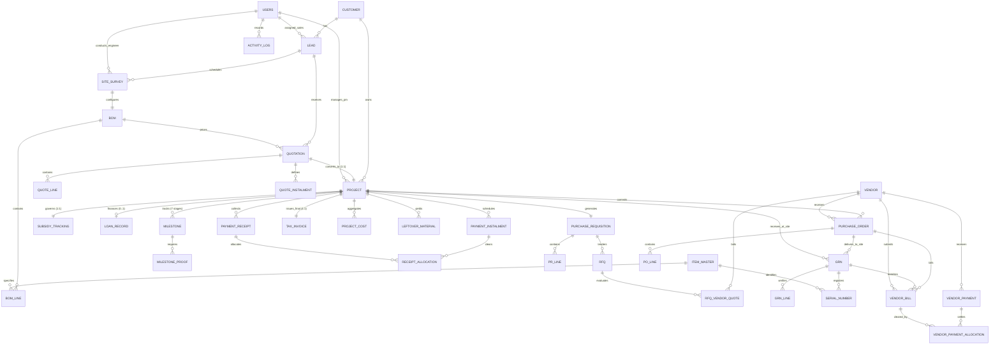

# Solaris EPC – Solar ERP System (Phase 1)
## Document 07: Data Entities, Schema Architecture & Entity Relationship Diagram (ERD)

---

### 1. Architectural Data Standards
1. **Universal Audit Headers:** Every transactional entity carries standard audit metadata:
   - `id` (UUID / BigInt Primary Key)
   - `created_by` (Foreign Key → `users.id`)
   - `created_at` (Timestamp with timezone)
   - `updated_by` (Foreign Key → `users.id`)
   - `updated_at` (Timestamp with timezone)
   - `is_deleted` (Boolean soft-delete flag, default: `false`)
2. **Monetary Precision:** All currency fields (`subtotal`, `tax`, `discount`, `grand_total`, `subsidy`, `cost`, `paid`, `balance`) are strictly stored as **`DECIMAL(14, 2)`**. Floating-point representations (`FLOAT`, `DOUBLE`) are strictly prohibited to prevent financial rounding inaccuracies.
3. **The `Project ID` Anchor:** While CRM records (`Customer`, `Lead`, `Site Survey`) originate independently, the moment a quotation is accepted, an immutable **`Project ID`** (`PRJ-YY-NNNN`) is generated. All subsequent downstream transactions—milestones, requisitions, POs, site GRNs, serialized equipment, subsidy filings, bank loans, customer instalments, payment receipts, final GST invoices, vendor bills, and project costs—are strictly bound by foreign key to this `Project ID`.

---

### 2. Comprehensive Entity Dictionary

#### 2.1 Customer & CRM Entities
- **`CUSTOMER`**
  - Primary Key: `customer_id`
  - Fields: `name`, `mobile` (Indexed, unique 10 digits), `alternate_mobile`, `email`, `billing_address`, `installation_address`, `city`, `district`, `state`, `pin_code`, `consumer_number` (DISCOM), `discom_name`, `customer_bank_account_no`, `customer_bank_ifsc`, `customer_bank_name` (stored for direct government subsidy crediting reference).
  - Cardinality: 1 Customer → Many Leads, 1 Customer → Many Projects.
- **`LEAD`**
  - Primary Key: `lead_id`
  - Foreign Keys: `customer_id`, `assigned_to` (`users.id`)
  - Fields: `lead_code`, `lead_source` (Walk-in, Referral, Meta Ads, Google Ads, IndiaMART, Website, Channel Partner, Other), `segment` (Residential, Commercial, Industrial), `monthly_electricity_bill` (Decimal), `sanctioned_load_kw` (Decimal), `discom`, `roof_ownership` (Owned, Rented), `roof_type` (Flat RCC, Pitched Tin, Tile), `status` (New, Contacted, Survey Scheduled, Quote Sent, Negotiation, Won, Lost, Junk), `follow_up_date` (Date), `lost_reason` (Text, required if Lost), `notes` (Text).
  - Cardinality: Belongs to Customer; 1 Lead → Many Surveys, 1 Lead → Many Quotations, 1 Lead → 1 Project (when Won).

#### 2.2 Field Engineering & Design Entities
- **`SITE_SURVEY`**
  - Primary Key: `survey_id`
  - Foreign Keys: `lead_id`, `engineer_id` (`users.id`)
  - Fields: `survey_schedule_time`, `survey_completion_time`, `gps_latitude`, `gps_longitude`, `usable_roof_area_sqft`, `roof_height_floors`, `shading_condition` (None, Partial, Heavy), `roof_orientation`, `structure_type_needed`, `connection_type` (Single Phase, Three Phase), `sanctioned_load_kw`, `average_monthly_units_kwh`, `earthing_condition`, `dc_cable_length_m`, `ac_cable_length_m`, `inverter_location_notes`, `customer_signature_url`, `status` (Scheduled, In Progress, Completed, Cancelled).
  - Child Entity: **`SURVEY_PHOTO`** (`photo_id`, `survey_id`, `photo_category` [Roof, Meter, DB, Inverter Wall, Other], `file_url`, `captured_at`). (Minimum 4 required).
  - Cardinality: Belongs to Lead; Feeds BOM.
- **`BOM` (Bill of Materials)**
  - Primary Key: `bom_id`
  - Foreign Keys: `survey_id`, `lead_id`, `template_id` (optional master reference)
  - Fields: `system_type` (On-grid, Hybrid, Off-grid), `recommended_kwp` (Decimal), `panel_type` (DCR, Non-DCR), `status` (Draft, Approved), `approved_by`, `approved_at`.
  - Child Entity: **`BOM_LINE`** (`bom_line_id`, `bom_id`, `item_id`, `quantity`, `unit`, `is_scalable_with_kw`).
  - Cardinality: Belongs to Survey/Lead; 1 BOM → Many Quotations, 1 BOM → 1 Purchase Requisition.

#### 2.3 Commercial & Quotation Entities
- **`QUOTATION`**
  - Primary Key: `quotation_id`
  - Foreign Keys: `lead_id`, `bom_id`, `salesperson_id` (`users.id`)
  - Fields: `quote_number` (`QT-YY-NNNN-Rn`), `version_number` (Integer: 1, 2, ...), `quote_date`, `validity_date` (Default: 15 days), `subtotal_taxable` (Decimal), `gst_amount` (Decimal), `discount_type` (Percentage, Fixed Amount), `discount_value` (Decimal), `grand_total` (Decimal), `central_subsidy_amount` (Decimal), `state_subsidy_amount` (Decimal), `total_subsidy_amount` (Decimal), `net_customer_cost` (Decimal = Grand Total - Total Subsidy), `estimated_annual_generation_kwh`, `estimated_annual_savings_inr`, `estimated_payback_years`, `terms_conditions_text`, `status` (Draft, Pending Approval, Sent, Accepted, Rejected, Expired, Revised), `is_locked` (Boolean).
  - Child Entity: **`QUOTE_LINE`** (`line_id`, `quotation_id`, `item_id`, `make`, `quantity`, `unit`, `unit_rate`, `gst_rate`, `line_taxable_amount`, `line_gst_amount`, `line_total_amount`).
  - Child Entity: **`QUOTE_INSTALMENT`** (`instalment_id`, `quotation_id`, `name`, `payer` [Customer, Bank], `amount` [Decimal], `percentage` [Decimal], `trigger_event` [On Order, On Milestone, On Loan Sanction, After WCR/SO, Fixed Date]).
  - Cardinality: Belongs to Lead; Accepted Quotation → 1:1 Project.

#### 2.4 Project Execution Entities
- **`PROJECT`**
  - Primary Key: `project_id` (`PRJ-YY-NNNN` - System Generated Text Code)
  - Foreign Keys: `customer_id`, `accepted_quotation_id`, `manager_id` (`users.id`)
  - Fields: `system_size_kwp`, `payment_mode` (Self-funded, Bank loan, Loan + margin money), `site_address`, `status` (Not Started, In Progress, Commissioned, Closed, On Hold, Cancelled), `target_installation_date`, `commissioning_date`, `closed_date`, `cancellation_reason`, `pnl_locked` (Boolean, default: `false`).
  - Cardinality: Core Anchor. 1:1 with accepted Quotation; 1 Project → Many Milestones, Instalments, GRNs, Costs, Documents; 1 Subsidy; 0..1 Loan.
- **`MILESTONE`**
  - Primary Key: `milestone_id`
  - Foreign Keys: `project_id`, `done_by` (`users.id`)
  - Fields: `name` (Kickoff, Material Received, Structure Installed, Panels Mounted, Wiring Complete, Commissioning, Handover), `sequence_order` (1 to 7), `status` (Pending, In Progress, Done), `planned_date`, `actual_date`, `remarks`.
  - Child Entity: **`MILESTONE_PROOF`** (`proof_id`, `milestone_id`, `file_url`, `uploaded_at`). (Mandatory to mark Done).
  - Cardinality: Belongs to Project.

#### 2.5 Supply Chain & Procurement Entities
- **`ITEM_MASTER`**
  - Primary Key: `item_id`
  - Fields: `item_code` (Unique), `name`, `make`, `category` (Panels, Inverter, Structure, Cables, ACDB/DCDB, Earthing, BOS, Labor, Transport), `unit` (Nos, Mtr, Set, Kg), `hsn_code`, `gst_rate` (Decimal: 5%, 12%, 18%), `is_serialised` (Boolean: true for panels, inverters, batteries), `standard_rate` (Decimal), `is_active` (Boolean).
- **`VENDOR`**
  - Primary Key: `vendor_id`
  - Fields: `vendor_name`, `gstin` (15 chars, checksum validated), `pan`, `contact_person`, `mobile`, `email`, `billing_address`, `state`, `bank_name`, `bank_account_no`, `bank_ifsc`, `payment_terms_days`, `categories_supplied`, `is_dcr_compliant` (Boolean), `is_almm_compliant` (Boolean), `rating` (1 to 5), `is_active` (Boolean).
- **`PURCHASE_REQUISITION` (PR)**
  - Primary Key: `pr_id`
  - Foreign Keys: `project_id`, `requested_by` (`users.id`)
  - Fields: `pr_number` (`PR-YY-NNNN`), `status` (Draft, Submitted, RFQ Sent, PO Created, Cancelled), `submission_date`.
  - Child Entity: **`PR_LINE`** (`pr_line_id`, `pr_id`, `item_id`, `bom_qty`, `leftover_deducted_qty`, `net_required_qty`, `unit`).
- **`RFQ` (Request for Quotation)**
  - Primary Key: `rfq_id`
  - Foreign Keys: `pr_id`, `project_id`
  - Fields: `rfq_number`, `created_date`, `status` (Draft, Quotes Received, Closed).
  - Child Entity: **`RFQ_VENDOR_QUOTE`** (`quote_id`, `rfq_id`, `vendor_id`, `item_id`, `quoted_rate`, `gst_rate`, `freight_amount`, `landed_cost_per_unit`, `delivery_lead_days`, `is_selected`).
- **`PURCHASE_ORDER` (PO)**
  - Primary Key: `po_id`
  - Foreign Keys: `project_id`, `vendor_id`, `approved_by` (`users.id`)
  - Fields: `po_number` (`PO-YY-NNNN`), `ship_to_address` (Defaults to project site address, editable), `po_date`, `promised_delivery_date`, `subtotal_amount`, `gst_amount`, `total_po_value`, `terms_conditions`, `status` (Draft, Pending Approval, Approved, Sent, Partially Received, Received, Closed, Cancelled).
  - Child Entity: **`PO_LINE`** (`po_line_id`, `po_id`, `item_id`, `quantity`, `unit_rate`, `gst_rate`, `total_amount`).
- **`GRN` (Goods Receipt Note at Site)**
  - Primary Key: `grn_id`
  - Foreign Keys: `po_id`, `project_id`, `received_by` (`users.id`)
  - Fields: `grn_number` (`GRN-YY-NNNN`), `receipt_date`, `vendor_challan_no`, `vendor_challan_date`, `challan_photo_url` (Mandatory), `status` (Submitted, Reversed), `reversal_reason`, `reversed_by`, `reversed_at`.
  - Child Entity: **`GRN_LINE`** (`grn_line_id`, `grn_id`, `item_id`, `ordered_qty`, `received_qty`).
  - Child Entity: **`SERIAL_NUMBER`** (`serial_id`, `serial_number_string` [Globally Unique], `item_id`, `grn_id`, `project_id`, `customer_id`, `scanned_at`).
- **`LEFTOVER_MATERIAL`**
  - Primary Key: `leftover_id`
  - Foreign Keys: `project_id`, `item_id`, `target_project_id` (optional), `approved_by` (`users.id`)
  - Fields: `quantity`, `action_taken` (Moved to Project, Returned to Vendor), `debit_note_reference`, `logged_at`.

#### 2.6 Regulatory & Subsidy Entities
- **`SUBSIDY_TRACKING`**
  - Primary Key: `subsidy_id`
  - Foreign Key: `project_id` (Unique 1:1)
  - Fields: `scheme_type` (Central PM Surya Ghar, State Scheme), `expected_subsidy_amount` (Copied from Quote, read-only), `current_stage` (1. Application Registered, 2. Feasibility Approved, 3. Installation Uploaded, 4. WCR Submitted, 5. Service Order Issued, 6. Net Metering Done, 7. Credited to Customer; Not Applicable, Rejected), `stage_entry_date` (Tracked for >45 days stuck alert), `portal_application_no`, `portal_registration_date`, `discom_consumer_no`, `feasibility_approval_date`, `feasibility_document_url`, `installation_portal_upload_date`, `wcr_submission_date`, `wcr_document_url`, `discom_service_order_no`, `discom_service_order_date`, `service_order_document_url`, `discom_visit_date`, `net_meter_serial_no`, `net_meter_installation_date`, `net_meter_photo_url`, `customer_subsidy_credited_amount`, `subsidy_credit_date`, `subsidy_credit_proof_url`.

#### 2.7 Financial, Billing & Payables Entities
- **`LOAN_RECORD`**
  - Primary Key: `loan_id`
  - Foreign Keys: `project_id` (Unique 0..1), `financier_id`
  - Fields: `loan_type`, `applied_date`, `requested_amount`, `documents_pending_list`, `sanction_date`, `sanctioned_amount`, `tranche_1_amount`, `tranche_1_date`, `tranche_1_utr`, `tranche_2_amount`, `tranche_2_date`, `tranche_2_utr`, `rejection_reason`, `status` (To Apply, Applied, Documents Pending, Sanctioned, Tranche 1 Received, Fully Disbursed, Rejected), `stage_entry_date` (Tracked for >21 days stuck alert).
- **`PAYMENT_INSTALMENT`**
  - Primary Key: `instalment_id`
  - Foreign Key: `project_id`
  - Fields: `description`, `payer` (Customer, Bank), `amount_due`, `due_trigger` (On Order, On Milestone, On Loan Sanction, After WCR/SO, Fixed Date), `due_date`, `amount_received`, `balance_amount`, `status` (Not Due, Due, Partially Paid, Paid, Overdue).
- **`PAYMENT_RECEIPT`**
  - Primary Key: `receipt_id`
  - Foreign Keys: `project_id`, `recorded_by` (`users.id`)
  - Fields: `receipt_number` (`RCT-YY-NNNN`), `receipt_date`, `mode` (Cash, UPI, Cheque, NEFT/RTGS, Bank Disbursement), `transaction_reference_utr`, `amount_received`.
  - Child Entity: **`RECEIPT_ALLOCATION`** (`allocation_id`, `receipt_id`, `instalment_id`, `allocated_amount`).
- **`TAX_INVOICE`**
  - Primary Key: `invoice_id`
  - Foreign Key: `project_id` (1 final invoice per project)
  - Fields: `invoice_number` (`INV/26-27/NNNN`), `financial_year` (`2026-27`), `invoice_date`, `system_description_lump_sum`, `taxable_value`, `cgst_amount`, `sgst_amount`, `igst_amount`, `total_invoice_value`, `payments_received_to_date`, `balance_due_amount`, `einvoice_irn`, `eway_bill_no`, `status` (Issued, Cancelled).
- **`VENDOR_BILL`**
  - Primary Key: `bill_id`
  - Foreign Keys: `vendor_id`, `po_id`, `grn_id`, `approved_by` (`users.id`)
  - Fields: `vendor_bill_number`, `bill_date`, `taxable_amount`, `gst_amount`, `tds_amount`, `net_payable_amount`, `three_way_match_status` (Draft, Matched, Mismatch, Approved, Partially Paid, Paid), `mismatch_justification`, `approval_date`.
- **`VENDOR_PAYMENT`**
  - Primary Key: `payment_id`
  - Foreign Keys: `vendor_id`, `recorded_by` (`users.id`)
  - Fields: `payment_date`, `mode` (NEFT, RTGS, Cheque), `payment_reference_utr`, `total_amount_paid`.
  - Child Entity: **`VENDOR_PAYMENT_ALLOCATION`** (`allocation_id`, `payment_id`, `bill_id`, `amount_allocated`).
- **`PROJECT_COST`**
  - Primary Key: `cost_id`
  - Foreign Key: `project_id`
  - Fields: `cost_category` (Material, Labor, Freight, Liaisoning, Miscellaneous), `source_ref_type` (GRN, Vendor Bill, Direct Expense), `source_ref_id`, `amount`, `expense_date`, `notes`.
- **`ACTIVITY_LOG`**
  - Primary Key: `log_id`
  - Foreign Key: `user_id` (`users.id`)
  - Fields: `entity_name`, `entity_id_code`, `action_type` (CREATE, UPDATE, STATUS_CHANGE, APPROVAL, OVERRIDE, REVERSAL), `old_values_json`, `new_values_json`, `action_timestamp`, `ip_address`. (Retained for minimum 3 years).

---

### 3. Master Entity Relationship Diagram (Mermaid ERD)

---

### 4. How `Project ID` Anchors the System Architecture
The `Project ID` (`PRJ-YY-NNNN`) functions as the system's gravitational core. Below is an architectural overview of how every transaction binds to it:

| Operational Subsystem | Anchored Entity | Linkage Mechanism to `Project ID` | Purpose of Binding |
| :--- | :--- | :--- | :--- |
| **Sales & Origin** | `QUOTATION` | `projects.accepted_quotation_id` | Historical record of original accepted pricing, kWp, and subsidy commitments. |
| **Field Execution** | `MILESTONE` | `milestones.project_id` | Enforces sequential execution and holds proof photos of physical rooftop assembly. |
| **Demand Gen** | `PURCHASE_REQUISITION`| `purchase_requisitions.project_id`| Ensures procurement is derived strictly from this project's BOM minus assigned leftovers. |
| **Procurement** | `PURCHASE_ORDER` | `purchase_orders.project_id` | Enforces direct-to-site delivery (ship-to address = customer rooftop address). |
| **Receiving** | `GRN` & `SERIAL_NUMBER`| `grns.project_id`, `serial_numbers.project_id`| Locks physical panel/inverter serials to this specific installation site and customer. |
| **Liaisoning** | `SUBSIDY_TRACKING` | `subsidy_tracking.project_id` (1:1) | Tracks PM Surya Ghar, DISCOM Feasibility, WCR, Service Order, and Net-Metering. |
| **Financing** | `LOAN_RECORD` | `loan_records.project_id` (0..1) | Governs margin money, Bank Tranche 1 release, and Bank Tranche 2 post-net-metering. |
| **Receivables** | `PAYMENT_INSTALMENT` | `payment_instalments.project_id` | Manages customer/bank payment schedule, tracking overdue and received amounts. |
| **Cash Receipts** | `PAYMENT_RECEIPT` | `payment_receipts.project_id` | Issues formal payment vouchers (`RCT-YY-NNNN`) clearing specific project instalments. |
| **Billing** | `TAX_INVOICE` | `tax_invoices.project_id` (1:1) | Issues single final GST invoice listing all GRN serial numbers without line item prices. |
| **Profitability** | `PROJECT_COST` | `project_costs.project_id` | Aggregates GRN materials at PO rates, labor, transport, and liaisoning into final P&L. |
| **Auditing** | `ACTIVITY_LOG` | `activity_logs.entity_id_code` | Chronological audit trail of all status transitions, overrides, and timestamps. |
