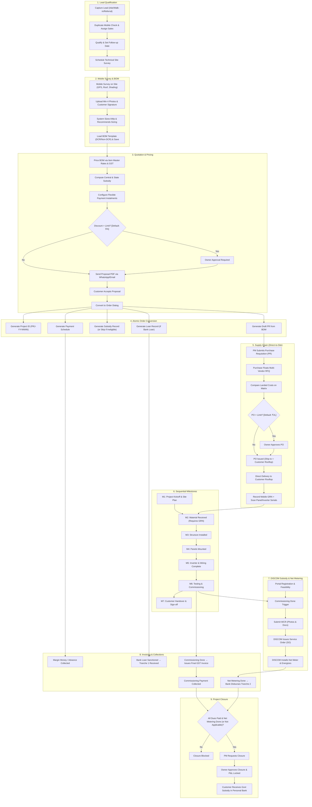
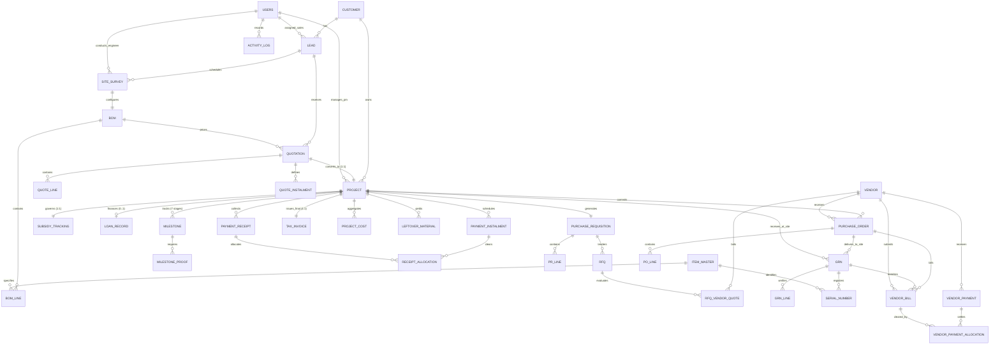

# Solaris EPC – Solar ERP System (Phase 1)
# Master Project Blueprint & UI/UX Architectural Specification

---

**Document Control:**
- **Project Title:** Solaris EPC – Solar ERP System (Phase 1)
- **Author Reference:** Comprehensive Architectural Blueprint & UI/UX Planning Document
- **Source Specification:** *Solar EPC ERP: Phase 1 Specification for Development* (Author: @Ashutosh Bhardwaj, Date: Nov 20, 2026)
- **Document Version:** 1.1.0 (Governance & Traceability Correction Pass)
- **Document Classification:** Enterprise Architecture & UI/UX Blueprint
- **Target Prototype Stack:** React 18+ | Vite | Tailwind CSS | Lucide Icons | Progressive Web App (PWA)

---

### Governance & Traceability Classification Framework
Throughout this master blueprint, every requirement, entity, rule, and design choice is explicitly categorized under one of three governance tags:

- 🟢 **`[SOURCE SPECIFICATION - CONFIRMED]`**: Explicitly mandated in the original 22-page development specification. Must be implemented verbatim.
- 🔵 **`[PROPOSED ARCHITECTURE / DESIGN CHOICE]`**: Architectural decompositions, screen layouts, wireframes, specific relational database schemas (e.g. data types, foreign keys), color tokens, typography, and responsive breakpoints developed to implement the specification in the upcoming React + Vite prototype.
- 🟡 **`[PENDING CLIENT CONFIRMATION]`**: Items explicitly marked in the source specification as open, awaiting client confirmation, or configurable defaults requiring managerial sign-off.

---

## Table of Contents
1. [Executive Summary & Project Overview](#1-executive-summary--project-overview)
2. [User Roles, Combined Permissions & Security Architecture](#2-user-roles-combined-permissions--security-architecture)
3. [Exhaustive Breakdown of All 23 Modules (Mapped to 11 Core Phase 1 Modules)](#3-exhaustive-breakdown-of-all-23-modules-mapped-to-11-core-phase-1-modules)
4. [Complete End-to-End Workflow & Process Architecture](#4-complete-end-to-end-workflow--process-architecture)
5. [Application Layout, Shell Architecture & Navigation System](#5-application-layout-shell-architecture--navigation-system)
6. [Screen-by-Screen Low-Fidelity Wireframe Specifications](#6-screen-by-screen-low-fidelity-wireframe-specifications)
7. [Data Architecture, Schema Dictionary & Entity Relationship Diagram (ERD)](#7-data-architecture-schema-dictionary--entity-relationship-diagram-erd)
8. [Business Rules, Validation Engine & Regulatory Gating](#8-business-rules-validation-engine--regulatory-gating)
9. [Dashboard & Business Intelligence Reporting Plan](#9-dashboard--business-intelligence-reporting-plan)
10. [UI/UX Enterprise Design System](#10-uiux-enterprise-design-system)
11. [Non-Functional Requirements & PWA Architecture](#11-non-functional-requirements--pwa-architecture)
12. [Confirmed Decisions, Open Questions & Risk Analysis](#12-confirmed-decisions-open-questions--risk-analysis)
13. [Document Registry & Traceability Review](#13-document-registry--traceability-review)

---

## 1. Executive Summary & Project Overview

### 1.1 Purpose & Mission 🟢 `[SOURCE SPECIFICATION - CONFIRMED]`
**Solaris EPC (Phase 1)** delivers a unified web and mobile system that runs a solar installation business from first enquiry to project closure. 

The primary architectural foundation is that **every transactional and operational record hangs off a single `Project ID` (`PRJ-YY-NNNN`)**. A project closes only when:
1. The customer and financing bank have paid in full.
2. DISCOM net metering is completed and verified.

### 1.2 Business Background & Operating Context 🟢 `[SOURCE SPECIFICATION - CONFIRMED]`
- **Company Profile:** Indian solar EPC company in **Rajasthan**, launching operations in **Jaipur**.
- **Market Segments:** Residential rooftop solar first; commercial and industrial (C&I) uses the exact same operational and financial flow.
- **Regulatory Scheme:** Aligned with **PM Surya Ghar: Muft Bijli Yojana** central government capital subsidies and Rajasthan state rooftop solar schemes.
- **Configurable Geography:** States, districts, and DISCOMs (e.g. JVVNL, AVVNL, JdVVNL) are database masters so new geographic areas can be added without code changes.
- **Fiscal Context:** Currency in INR (₹), GST applies, financial year April to March.

### 1.3 Core Operational Realities (Distinctions from Generic ERPs) 🟢 `[SOURCE SPECIFICATION - CONFIRMED]`
1. **Direct-to-Customer Subsidy Crediting:** Subsidy under PM Surya Ghar and state schemes is paid by the government **directly into the customer's personal bank account**. The company tracks it for the customer but **never receives it**. Subsidy is **never counted as company money or company receivable**.
2. **Zero-Warehouse Operating Model:** **No warehouse / no godown.** Every item is bought for a specific project and delivered straight to the customer's site.
3. **Pre-Fabricated Mounting Structures:** Structure iron is bought from vendors and assembled on site. There is **no in-house fabrication step**.
4. **Direct Serial Number Traceability:** Mandatory serial numbers captured at site GRN for panels, inverters, and batteries via barcode scan or bulk paste, verified for global system uniqueness.
5. **Two-Tranche Solar Bank Loans:** Customers pay from own funds or through a bank loan. The bank pays in two tranches (Tranche 1 upon loan sanction; Tranche 2 due only after WCR is submitted and DISCOM Service Order / Net Metering is done); the customer pays the rest as margin money.
6. **Go-Live Baseline:** No existing data to migrate; the system starts with master data only loaded via CSV import.

### 1.4 Scope Boundaries 🟢 `[SOURCE SPECIFICATION - CONFIRMED]`
- **In Scope for Phase 1:** Leads and follow-ups (CRM); Site survey (mobile) and system design with bill of materials (BOM); Quotation with subsidy calculation, approval and conversion to order; Projects with installation milestones and proof photos; Vendors, purchase requisition, RFQ, purchase order, goods receipt (GRN) with serial numbers; Project material tracking: delivery to site, serial numbers, leftovers (no warehouse); Government subsidy tracking: WCR, DISCOM Service Order (SO), net metering and credit to the customer; Customer payments (self-funded or bank loan), invoices and receipts; Vendor bills and vendor payments; Project closure with final project P&L; Dashboard, reports, notifications and settings.
- **Out of Scope for Phase 1 (Planned for Phase 2):** AMC, service tickets and warranty claims; Channel partner or dealer portal; Inverter monitoring integrations; Full accounting (ledger, balance sheet; Phase 1 exports to Tally XML format instead); Payroll and HR.

### 1.5 Technology Preference for Future Prototype 🔵 `[PROPOSED ARCHITECTURE / DESIGN CHOICE]`
- **Frontend Stack:** React 18+ Single Page Application bundled with Vite.
- **Styling Architecture:** Tailwind CSS implementing an enterprise design system.
- **Component Primitives & Icons:** Accessible UI components paired with Lucide React icons.
- **Field Delivery:** Progressive Web App (PWA) architecture supporting offline draft caching for site surveys, milestone updates, and site GRN forms.

---

## 2. User Roles, Combined Permissions & Security Architecture

### 2.1 Role Profiles & Operational Scopes 🟢 `[SOURCE SPECIFICATION - CONFIRMED]`
1. **Owner / Admin:** Global visibility (`All: V C E`). Sole approval authority for quotation discounts above limit, POs above limit, 3-way match mismatches, GRN reversal entries, reopening lost leads, and final Project Closure.
2. **Sales Executive:** Manages own assigned leads (`Own: V C E`), drafts quotes, shares proposals via WhatsApp/Email, and executes Order Conversion. Cannot see other sales executives' leads.
3. **Survey Engineer:** Executes assigned surveys (`Assigned: V C E`) via mobile, auto-captures GPS, uploads minimum 4 mandatory photos, captures customer signature, and recommends system sizing.
4. **Project Manager (PM):** Manages assigned projects (`Assigned: V C E`), submits BOM-driven PRs, approves leftover transfers, verifies site deliveries, marks milestones, and submits closure requests.
5. **Purchase Officer:** Manages vendor master, conducts multi-vendor RFQ comparisons, issues POs, and records mobile site GRNs with panel/inverter serial scanning (`V C E`).
6. **Accounts Officer:** Manages customer payment schedules, records receipts (`RCT-YY-NNNN`), tracks bank loan tranches, issues final GST tax invoices (`INV/26-27/NNNN`), verifies 3-way match, and manages vendor disbursements (`V C E`).
7. **Liaison Officer (Subsidy):** Coordinates PM Surya Ghar portal filings, DISCOM feasibility, WCR submission, DISCOM Service Order (SO), net-metering completion, and customer subsidy credit records (`V C E`).

### 2.2 Master Role-Permission Matrix 🟢 `[SOURCE SPECIFICATION - CONFIRMED]`

| Module (Spec Row) | Owner / Admin | Sales Executive | Survey Engineer | Project Manager | Purchase | Accounts | Liaison (Subsidy) |
| :--- | :---: | :---: | :---: | :---: | :---: | :---: | :---: |
| **Leads** | All: V C E | Own: V C E | Assigned: V | V | — | — | — |
| **Survey and BOM** | V C E A | V | Assigned: V C E | V | V | — | — |
| **Quotation** | V C E A *(discounts)* | Own: V C E | V | V | V | V | V |
| **Projects and milestones** | V C E | Own: V | V | Assigned: V C E | V | V | V |
| **Requisition, RFQ, PO** | V A | — | — | C *(requisition)* | V C E | V | — |
| **GRN and site material** | V | — | — | V | V C E | V | — |
| **Subsidy and WCR** | V | V | — | V | — | V | V C E |
| **Customer payments and loans** | V A | V | — | V | — | V C E | V |
| **Vendor bills and payments** | V A | — | — | — | V | V C E | — |
| **Project closure** | A | — | — | Request | — | V | — |
| **Settings and masters** | V C E | — | — | — | Vendors, items: C E | Instalment templates: C E | Subsidy rules: C E |

*Legend: V = view, C = create, E = edit, A = approve, — = no access.*

### 2.3 Role Flexibility & Multi-Role Union 🟢 `[SOURCE SPECIFICATION - CONFIRMED]`
- **Dynamic Master Configuration:** Roles must be configurable by the admin (rename, add, change permissions) without code changes. There is no fixed number of users per role.
- **Multi-Role Assignment:** One user can hold several roles simultaneously, and their permissions **combine additively** (Union of entitlements).
- **Server Enforcement:** Role-based access must be enforced on the server, not just hidden in the UI.

---

## 3. Exhaustive Breakdown of All 23 Modules (Mapped to 11 Core Phase 1 Modules)

### 3.1 Structural Mapping & Architectural Clarification 🔵 `[PROPOSED ARCHITECTURE / DESIGN CHOICE]`
> [!NOTE]
> The **23 modules** detailed below represent a granular functional, subsystem, and screen-level breakdown derived directly from the **11 broader business modules** defined in Section 1 (Scope) and Section 3 (Roles & Permissions) of the source PDF. This decomposition ensures that every discrete operational subsystem, user interface screen, and background service is rigorously specified prior to frontend prototype construction.

| Broad Spec Module (PDF §1, §3) | Granular Architectural Subsystems / Modules (Blueprint §3) |
| :--- | :--- |
| **1. Leads (CRM)** | Module 02: Leads and CRM |
| **2. Survey and BOM** | Module 03: Site Survey<br>Module 04: System Design and BOM |
| **3. Quotation** | Module 05: Quotations |
| **4. Projects and Milestones** | Module 06: Projects (Master Hub)<br>Module 07: Installation Milestones |
| **5. Requisition, RFQ, PO** | Module 09: Procurement Overview<br>Module 10: Purchase Requisition (PR)<br>Module 11: Request for Quotation (RFQ)<br>Module 12: Purchase Orders (PO) |
| **6. GRN and Site Material** | Module 08: Vendors Directory<br>Module 13: Goods Receipt Note (GRN at Site)<br>Module 14: Project Materials (Reconciliation & Leftovers) |
| **7. Subsidy and WCR** | Module 15: Subsidy Tracking (PM Surya Ghar, WCR & Net Metering) |
| **8. Customer Payments and Loans** | Module 16: Customer Payments<br>Module 17: Bank Loans<br>Module 18: Invoices and Receipts |
| **9. Vendor Bills and Payments** | Module 19: Vendor Bills and Payments |
| **10. Project Closure and P&L** | Module 20: Project Costs and P&L |
| **11. Dashboard, Reports, Notifications, Settings** | Module 01: Dashboard<br>Module 21: Reports<br>Module 22: Notifications Engine<br>Module 23: Settings and System Masters |

---

### 3.2 Granular Module Breakdown Summary

#### Module 01: Dashboard 🟢 `[SOURCE SPECIFICATION - CONFIRMED]`
- **Purpose:** Executive and operational overview of sales, project execution, cash flow, and operational bottlenecks.
- **Key Metric Tiles:** Leads this month and conversion %; kW sold this month; Projects by status (with delayed count); Receivables split by customer and bank; Collections this month; Payables due this week; Pending deliveries; Projects waiting for WCR / SO / net metering; Stuck subsidies (>45d); Loans awaiting sanction or tranche 2 (>21d); Customers with subsidy not yet credited; Overdue follow-ups.
- **Rule:** Every tile opens the pre-filtered list behind it. Totals must equal the sum of underlying records (automated test required).

#### Module 02: Leads and CRM 🟢 `[SOURCE SPECIFICATION - CONFIRMED]`
- **Purpose:** Capture every enquiry and ensure none is forgotten.
- **Screens:** Leads board (Kanban by status, drag to change status); List view with search and filters; Lead form and detail page (contact, status, follow-up date, survey history, quotations, notes timeline, linked project); CSV import (with duplicate check on mobile) and CSV export.
- **Fields:** Customer name*, Mobile* (10 digits Indian), Alternate mobile, Email, Address, City, District, State* (default: Rajasthan), PIN (6 digits), Lead source* (master list: walk-in, referral, Meta ads, Google ads, IndiaMART, website, channel partner, other), Segment* (Residential / Commercial / Industrial), Monthly electricity bill (₹), Sanctioned load (kW), DISCOM, Roof ownership, Roof type, Assigned to*, Follow-up date (mandatory for every open lead), Lost reason (mandatory when status = Lost), Notes. (* = required).
- **Statuses:** `New` → `Contacted` → `Survey Scheduled` → `Quote Sent` → `Negotiation` → `Won`. Exits: `Lost` (requires reason), `Junk`. `Won` is set automatically when a quotation is accepted, not by hand. Lost can be reopened to Contacted only by Owner.
- **Rules:** Duplicate warning on existing mobile; follow-up date required for open leads; overdue follow-ups show on dashboard and trigger daily 9:00 AM reminder digest. Every status change and note logged with user and timestamp.

#### Module 03: Site Survey 🟢 `[SOURCE SPECIFICATION - CONFIRMED]`
- **Purpose:** Record site facts once, on a phone, and turn them into a system size and material list.
- **Screens:** Survey schedule (date, time, engineer) from lead page; Engineer's "My surveys" list on mobile; Survey form (mobile-first, works on slow networks, saves draft if offline).
- **Fields:** Survey date and time, Engineer, GPS location (auto), Roof type, Usable roof area (sq ft), Roof height / floors, Shading (None / Partial / Heavy), Orientation, Structure type needed, Connection type (single / three phase), Sanctioned load (kW), Average monthly units (kWh), Earthing condition, DC and AC cable run lengths (m), Inverter location, Photos (**minimum 4: roof, meter, DB, inverter wall**), Customer signature, Notes.
- **Rules:** Completed status requires minimum 4 mandatory photos and recommended kW.

#### Module 04: System Design and BOM 🟢 `[SOURCE SPECIFICATION - CONFIRMED]`
- **Purpose:** Determine recommended capacity and generate Bill of Materials.
- **Features:** Recommended system size (kWp) suggested from monthly units (engineer can override); System type: On-grid, Hybrid, Off-grid; Panel type: DCR or non-DCR (DCR required for subsidy).
- **BOM Templates:** Admin-managed per type and size (e.g. "3 kW On-grid DCR"). Each line: item, quantity, unit. Quantities scale with kW where marked. Items from item master (panels, inverter, structure, DC/AC cables, ACDB/DCDB, earthing kit, lightning arrestor, MC4 connectors, net meter, labour, transport).
- **Rules:** Saving BOM marks survey Completed and sets lead to Quote Sent once quote is issued. Approved BOM is the single source for quotation, purchase requisition, and project costing.

#### Module 05: Quotations 🟢 `[SOURCE SPECIFICATION - CONFIRMED]`
- **Purpose:** Price the BOM, show customer net cost after subsidy, and turn acceptance into a project.
- **Screens:** Quotation list (filters: status, size band, salesperson, date); Quotation builder; Quotation PDF preview; Share by WhatsApp / email; Convert-to-order dialog.
- **Contents:** Header: quote number (`QT-YY-NNNN-Rn`), date, validity date (default 15 days), customer, site address, salesperson. Lines from BOM: item, make, quantity, unit, rate, GST % (from item master), amount. Option per quote to group lines as a package price on PDF. Totals: subtotal, GST (CGST+SGST or IGST by state), grand total.
- **Subsidy Engine:** Central subsidy (from central slab master) + state subsidy (from state rule master: per kW rate with cap) = total subsidy.
- **Net Customer Cost:** $\text{Grand Total} - \text{Total Subsidy}$. Must never be below zero (block save). Shown for information only; customer pays grand total to company and receives subsidy from government.
- **Payment Terms:** Set by user on each quote (no fixed split): any number of instalments (name, payer [customer/bank], amount in ₹ or %, trigger [on order, on a milestone, on loan sanction, after WCR and SO, or fixed date]). Sum of instalments must equal grand total.
- **Rules:** Revising sent quote creates version `R1`, `R2...`; old versions read-only. Commercial discount entered as fixed ₹ or % of quote; PDF shows ₹. Discount above configurable limit 🟡 `[PENDING CLIENT CONFIRMATION - DEFAULT: 5% OF GRAND TOTAL]` requires Owner approval before sending. Quotation expires automatically after validity date. Accepted quote creates project and is permanently locked.

#### Module 06: Projects (Master Hub) 🟢 `[SOURCE SPECIFICATION - CONFIRMED]`
- **Purpose:** Run each installation to a checklist, with proof, and know its status at a glance.
- **Screens:** Project list (cards and table; filters: status, manager, state, stage, delayed); Project detail page with tabs: Overview, Milestones, Materials, Subsidy, Payments, Documents, Costs, Activity.
- **Status Header:** Displays project stage, payment mode, balance due, and subsidy / DISCOM stage (WCR, SO, net metering).
- **Statuses:** `Not Started` → `In Progress` → `Commissioned` → `Closed`; Side exits: `On Hold`, `Cancelled`.
- **Rules:** Created upon quotation acceptance via Convert-to-Order dialog. Moves to In Progress on first milestone started. Commissioned when commissioning milestone is Done. Closed strictly when all customer and bank instalments are Paid AND subsidy record shows Net Metering Done (or Not Applicable); then Owner approves. Cancelled requires reason, blocked once material has been received at site. Deleting a project with transactions is blocked.

#### Module 07: Installation Milestones 🟢 `[SOURCE SPECIFICATION - CONFIRMED]`
- **The 7 Default Milestones:** 1. Project kickoff and site plan; 2. Material received at site; 3. Structure installed; 4. Panels mounted; 5. Inverter and wiring complete; 6. Testing and commissioning; 7. Handover to customer (warranty documents, customer signature).
- **Milestone Fields:** Status (Pending / In progress / Done), planned date, actual date, done by, proof photos (required to mark Done), remarks.
- **Rules:** Milestones complete in order: cannot mark Done while earlier is Pending (admin override with logged reason). "Material received at site" can ONLY be marked Done after at least one GRN exists. "Testing and commissioning" Done sets commissioning date and unlocks WCR step and commissioning payment. Project is Delayed when today > planned date and milestone not Done (shown in red). Proof photos are required to mark Done. *(Note: Specific photo categories per milestone are 🔵 `[PROPOSED ARCHITECTURE]`)*.

#### Module 08: Vendors Directory 🟢 `[SOURCE SPECIFICATION - CONFIRMED]`
- **Purpose:** Maintain supplier master with tax and technical compliance.
- **Fields:** Name*, GSTIN (15 characters with checksum validation), PAN, Contact person, Mobile, Email, Billing address, State, Bank details, Payment terms (days), Categories supplied, ALMM / DCR compliant (for module vendors), Rating, Active flag.

#### Module 09: Procurement Overview 🟢 `[SOURCE SPECIFICATION - CONFIRMED]`
- **Purpose:** Zero-warehouse purchasing control. Every purchase belongs to a specific project and is delivered directly to customer site. Structure iron bought, not fabricated.
- **Features:** Track ordered vs. received vs. pending deliveries by vendor and due date; hardware serial trace.

#### Module 10: Purchase Requisition (PR) 🟢 `[SOURCE SPECIFICATION - CONFIRMED]`
- **Purpose:** Direct-from-BOM demand generation.
- **Features:** Created automatically as draft from project BOM on order conversion (`PR-YY-NNNN`). $\text{Quantity to buy} = \text{BOM quantity} - \text{leftover already moved to this project}$. Project manager submits. Ordering $>5\%$ above BOM quantity requires Project Manager approval.

#### Module 11: Request for Quotation (RFQ) 🟢 `[SOURCE SPECIFICATION - CONFIRMED]`
- **Purpose:** Multi-vendor competitive pricing.
- **Features:** Purchase user picks 1 or more vendors for PR lines, enters rate, GST, and delivery time. Comparison screen highlights lowest landed cost per line.

#### Module 12: Purchase Orders (PO) 🟢 `[SOURCE SPECIFICATION - CONFIRMED]`
- **Purpose:** Binding supply contracts.
- **Features:** Created from chosen vendor quote (`PO-YY-NNNN`). Vendor, project, ship-to = project's site address (editable), lines, taxes, delivery date, terms. PO above configurable value 🟡 `[PENDING CLIENT CONFIRMATION - DEFAULT: ₹2,00,000]` needs Owner approval. PO PDF sent via email or WhatsApp. PO cancellation is blocked once any GRN exists.

#### Module 13: Goods Receipt Note (GRN at Site) 🟢 `[SOURCE SPECIFICATION - CONFIRMED]`
- **Purpose:** Mobile receipt at site acknowledging physical component arrival.
- **Features:** Recorded on mobile by PM or installer when material reaches site (`GRN-YY-NNNN`). Received quantity per line (partial deliveries allowed), vendor invoice / challan number and date, photo of the challan.
- **Serial Numbers:** Serial numbers are mandatory for serialized items (panels, inverters, batteries) by barcode scan or bulk paste. A serial number can belong to only one project (globally unique across system).
- **Corrections:** GRN is never deleted. Fixed by reversal entry with reason and Owner approval.

#### Module 14: Project Materials (Reconciliation & Leftovers) 🟢 `[SOURCE SPECIFICATION - CONFIRMED]`
- **Materials Tab:** BOM quantity vs. ordered (PO) vs. received at site (GRN) vs. leftover quantity per item, with value and variance. Variance $>5\%$ is highlighted.
- **Leftover Material:** Recorded after installation. Each leftover is either moved to another project (PM approval) or returned to vendor (debit note against vendor bill).

#### Module 15: Subsidy Tracking (PM Surya Ghar & DISCOM) 🟢 `[SOURCE SPECIFICATION - CONFIRMED]`
- **Purpose:** Track subsidy and DISCOM process from application to net metering.
- **7 Stages:**
  1. *Application registered:* Portal application no, registration date, consumer no, scheme (central/state) [At order conversion].
  2. *DISCOM feasibility:* Approval date, approval document [Should be done before installation - warning, not hard block].
  3. *Installation details uploaded:* Portal upload date [After commissioning].
  4. *WCR submitted:* WCR submission date, WCR document, photos [Unlocked ONLY after Milestone 6 is Done].
  5. *Service Order (SO) issued:* SO number, SO date, SO document [Only after WCR submitted].
  6. *Net metering done:* DISCOM visit date, net meter number, installation date [Only after SO. Last step of process and condition for project closure. Unlocks Bank Tranche 2].
  7. *Subsidy credited to customer:* Amount, credit date, proof (bank SMS or statement screenshot 🟡 `[PENDING CLIENT CONFIRMATION ON EXACT PROOF TYPE]`) [Recorded when customer confirms. Can be updated after project is closed].
- **Rules:** One subsidy record created per project on order conversion (skip with a reason if not eligible, e.g. commercial). Expected subsidy copied from quote (read-only). Record is Stuck when in one stage $>45$ days (configurable) → weekly liaison alert. "Pending subsidy credit" list for customers with net metering done but subsidy not credited. Subsidy never enters company receivables.

#### Module 16: Customer Payments 🟢 `[SOURCE SPECIFICATION - CONFIRMED]`
- **Purpose:** Manage customer receivables schedule, instalments, and receipts.
- **Payment Schedule:** Created on order conversion from quotation instalments. Sum of instalments = grand total.
- **Instalments:** Description, payer (customer/bank), amount due, due trigger, due date, amount received, status (Not Due, Due, Partially Paid, Paid, Overdue).
- **Receipts:** Recorded against 1+ instalments (`RCT-YY-NNNN`). Mode: cash, UPI, cheque, NEFT/RTGS, bank disbursement. Reference, date, amount. Partial payments allowed (status Partially Paid with balance). Receipt PDF generated and shared on WhatsApp.
- **Rules:** Overdue amount $\le$ outstanding amount, always. Outstanding = total due - total received.

#### Module 17: Bank Loans 🟢 `[SOURCE SPECIFICATION - CONFIRMED]`
- **Purpose:** Governs bank-financed rooftop projects.
- **Schedule Structure:** Margin money (customer, advance); Bank tranche 1 (bank, due on sanction, released immediately); Bank tranche 2 (bank, due only after WCR and Net Metering are done). Tranche 2 displays *"Waiting for WCR / SO"* until recorded.
- **Loan Record:** Financier, loan type, applied date, requested amount, docs pending list, sanction date and amount, Tranche 1 (date, amount, UTR), Tranche 2 (date, amount, UTR), rejection reason, status (`To Apply` → `Applied` → `Documents Pending` → `Sanctioned` → `Tranche 1 Received` → `Fully Disbursed`; `Rejected`). Stuck after 21 days in one status (configurable). Rejected prompts change of payment mode.

#### Module 18: Invoices and Receipts 🟢 `[SOURCE SPECIFICATION - CONFIRMED]`
- **Single Final GST Tax Invoice:** Exactly one final invoice per project (`INV/26-27/NNNN`), issued at commissioning (or when accounts chooses). Shows: System description and single lump-sum value with GST; List of supplied items with make, quantity, and serial numbers (panels, inverter, battery) from GRNs without per-item prices; Payments already received and balance due. E-invoice and e-way bill fields stored for later integration.

#### Module 19: Vendor Bills and Payments 🟢 `[SOURCE SPECIFICATION - CONFIRMED]`
- **Vendor Bill Entry:** Entered against PO and GRN (bill no, date, amount, GST, TDS).
- **Three-Way Match:** Bill approved for payment ONLY when bill qty $\le$ GRN qty and rate = PO rate (tolerance configurable). Mismatches require Owner approval.
- **Vendor Payment:** Date, mode, reference, amount against 1+ bills. Vendor ageing buckets (0-30, 31-60, 61-90, 90+ days).

#### Module 20: Project Costs and P&L 🟢 `[SOURCE SPECIFICATION - CONFIRMED]`
- **Costs Tab:** Material cost (from received quantity at PO rate), labour, transport, liaisoning, and other expenses entered against project. Feeds project P&L. Permanently locked upon project closure.

#### Module 21: Reports 🟢 `[SOURCE SPECIFICATION - CONFIRMED]`
- **Features:** Date range filter; export to Excel and PDF.
- **Sales:** Lead source performance, Salesperson leaderboard, Pipeline value by stage, Quote-to-win, Lost reasons, kW sold by month / district / size.
- **Operations:** Project ageing, Milestone bottlenecks, Delayed projects, Survey-to-quote conversion, Material variance by project.
- **Procurement:** PO register, Vendor-wise purchases, Pending deliveries (PO vs GRN), Leftover material, Serial-number history.
- **Money:** Receivables ageing by payer (customer/bank), Collections, Subsidy pipeline, Loan pipeline, Vendor payables ageing, GST summary (output and input), Project P&L (revenue, material, labour, transport, other, margin %).
- **Integrity Rule:** Report totals must equal sum of underlying records (automated test required).

#### Module 22: Notifications Engine 🟢 `[SOURCE SPECIFICATION - CONFIRMED]`
- **Delivery Channels:** In-app always; WhatsApp and email where configured; templates editable in Settings.
- **The 14 Specification Triggers:** Lead assigned; Follow-up due today/overdue (daily 9:00 AM digest); Survey scheduled; Quote pending approval; Quote shared; Order confirmed; PO pending approval; Delivery due today/late; Milestone done; Commissioning done (submit WCR); Net metering done (claim tranche 2); Instalment due/overdue; Subsidy or loan stuck (weekly digest); Project ready to close.

#### Module 23: Settings and System Masters 🟢 `[SOURCE SPECIFICATION - CONFIRMED]`
- **Masters:** Lead sources, Segments, Items, BOM templates, Optional instalment templates, Central subsidy slabs, State subsidy rules, States / Districts / DISCOMs, Financiers, Users and roles (multi-role), Milestone template, WhatsApp / email templates, Company profile (name, GSTIN, address, logo, bank details for invoices).
- **Configurability:** Masters, templates, thresholds (stuck days, approval limits, tolerance %) editable by admin without code changes.

---

## 4. Complete End-to-End Workflow & Process Architecture

### 4.1 Master End-to-End Flowchart 🟢 `[SOURCE SPECIFICATION - CONFIRMED]`



### 4.2 Verbatim Sequential Gating & Blocking Rules 🟢 `[SOURCE SPECIFICATION - CONFIRMED]`
1. **Milestones Complete in Order:** A milestone cannot be marked Done while an earlier one is Pending (admin override with a reason is logged).
2. **Material Received Gating:** "Material received at site" can ONLY be marked Done after at least one GRN exists for this project.
3. **Commissioning Trigger:** "Testing and commissioning" Done sets project commissioning date and unlocks the WCR step in subsidy record and the commissioning payment instalment.
4. **Subsidy Stage Sequence:** WCR Submitted only after project commissioning. Service Order (SO) Issued only after WCR. Net Metering Done only after SO.
5. **Bank Tranche 2 Unlock:** Bank Tranche 2 is due only after WCR is submitted and the SO / net metering is done. Displays *"Waiting for WCR / SO"* until recorded.
6. **Project Closure Condition:** As verbatim specified in Section 11 (page 12) of the source specification:
   > *"Closed only when all customer and bank instalments are Paid and the subsidy record shows Net Metering Done (or Not Applicable); then Owner approves. Subsidy credit to the customer is not a closure condition."*
   *(Note: `Not Applicable` is explicitly provided in the source specification on Page 9 and Page 12 for projects that are not eligible for subsidy, e.g. commercial installations).*
7. **Cancellation & Deletion Blocks:**
   - Deleting a lead with a project, or a project with transactions, is blocked. Use Cancel instead.
   - Project Cancelled requires a reason and is blocked once material has been received at site.
   - PO Cancel blocked once any GRN exists.

---

## 5. Application Layout, Shell Architecture & Navigation System

### 5.1 Common Layout Components 🔵 `[PROPOSED ARCHITECTURE / DESIGN CHOICE]`
- **Desktop Viewport:** 260px fixed left sidebar, 64px persistent top bar with global search (`Ctrl + K`), notification bell with unread count, and role context indicator.
- **Top Bar Global Search 🟢 `[SOURCE SPECIFICATION - CONFIRMED]`:** Global search by customer name, mobile, Project ID or serial number.
- **Project Header Status Ribbon 🟢 `[SOURCE SPECIFICATION - CONFIRMED]`:** Displays project stage, payment mode, balance due, and subsidy / DISCOM stage (WCR, SO, net metering).
- **Action Buttons 🟢 `[SOURCE SPECIFICATION - CONFIRMED]`:** A clear "next action" button on each record (e.g. "Schedule survey", "Send quote", "Record GRN", "Submit WCR"). Confirmation dialog on every irreversible action (accept quote, approve PO, record GRN, close project).

### 5.2 Sidebar Navigation Structure 🔵 `[PROPOSED ARCHITECTURE / DESIGN CHOICE]`
```
├── 1. Dashboard
├── 2. Leads (CRM)
├── 3. Site Surveys
├── 4. Design & BOM
├── 5. Quotations
├── 6. Projects (Master Hub with 8 Tabs: Overview, Milestones, Materials, Subsidy, Payments, Docs, Costs, Activity)
├── 7. Procurement
│   ├── Purchase Requisitions (PR)
│   ├── RFQ & Comparison
│   ├── Purchase Orders (PO)
│   ├── Goods Receipt (GRN)
│   └── Leftover Inventory
├── 8. Subsidy & DISCOM
│   ├── Subsidy Pipeline
│   ├── Stuck Subsidies (>45d)
│   └── Pending Subsidy Credit
├── 9. Finance & Accounts
│   ├── Customer Payments & Receipts
│   ├── Bank Loans Pipeline
│   ├── Tax Invoices
│   └── Vendor Bills & 3-Way Match
├── 10. Vendors Directory
├── 11. Reports & Analytics
└── 12. Settings & Masters
```

---

## 6. Screen-by-Screen Low-Fidelity Wireframe Specifications 🔵 `[PROPOSED ARCHITECTURE / DESIGN CHOICE]`

The blueprint details 24 dedicated low-fidelity wireframes in [06_Screen_Wireframes.md](file:///Users/navgurukul/Desktop/epc/06_Screen_Wireframes.md):
1. `Screen 01: Login & Authentication` (Email/Mobile + Password/OTP; 30 min idle timeout).
2. `Screen 02: Main Executive Dashboard` (12 KPI summary tiles opening filtered lists).
3. `Screen 03: Leads List Screen` (Tabular grid, search, filters, CSV import/export).
4. `Screen 04: Leads Kanban Board` (Drag-and-drop status board with one-tap WhatsApp icon).
5. `Screen 05: Add / Edit Lead Form` (Contact, load, bill, roof, mobile duplicate warning).
6. `Screen 06: Lead Details Screen` (Profile, survey history, quotes table, timeline notes).
7. `Screen 07: Site Survey Form` (Mobile-first, auto-GPS, 4 photos: Roof, Meter, DB, Inverter Wall, signature).
8. `Screen 08: System Design & BOM Screen` (kWp sizing suggestion, BOM template loader, scaling lines).
9. `Screen 09: Quotations List Screen` (Quote register, version indicator, net cost display).
10. `Screen 10: Quotation Builder Screen` (Line pricing, central/state subsidy engine, instalment scheduler).
11. `Screen 11: Quotation PDF Preview & Dispatch` (PDF proposal preview, WhatsApp/Email share).
12. `Screen 12: Projects List Screen` (Project directory, cards/table toggle, delayed flags in red).
13. `Screen 13: Project Overview Screen` (Persistent ribbon header and summary cards).
14. `Screen 14: Project Milestones Screen` (7-stage checklist, proof photo upload, sequence gating).
15. `Screen 15: Project Materials Screen` (BOM vs PO vs GRN vs Leftover reconciliation, >5% variance flag).
16. `Screen 16: Subsidy & DISCOM Details Screen` (7-stage pipeline, document checklist, stuck alert).
17. `Screen 17: Customer Payments & Loans Screen` (Instalment schedule, 2 loan tranches, receipts).
18. `Screen 18: Vendor Directory Screen` (Vendor register, GSTIN format check, ALMM/DCR tags).
19. `Screen 19: Procurement & RFQ Comparison` (Side-by-side vendor matrix, lowest landed cost).
20. `Screen 20: Goods Receipt Note (GRN) Screen` (Mobile challan photo, barcode serial scanner).
21. `Screen 21: Final GST Tax Invoice Screen` (Lump-sum system billing, serialized hardware list without item prices).
22. `Screen 22: Reports & Analytics Hub Screen` (Sales, Operations, Procurement, Money reports with Excel/PDF).
23. `Screen 23: Notifications Center Screen` (Alerts feed, approvals queue, daily digests).
24. `Screen 24: Settings & Masters Screen` (Masters management, thresholds, role permissions).

---

## 7. Data Architecture, Schema Dictionary & Entity Relationship Diagram (ERD)

### 7.1 Database Standards 🟢 `[SOURCE SPECIFICATION - CONFIRMED]`
- **Universal Transactional Headers:** All transactional records carry: `id`, `created_by`, `created_at`, `updated_by`, `updated_at`, and `soft-delete flag`.
- **Decimal Precision:** Money fields are stored as **`decimal (2 places)`**, never float. *(Note: Implementation type `DECIMAL(14,2)` is 🔵 `[PROPOSED ARCHITECTURE]`)*.
- **Primary Operational Spine:** Every record hangs off a single **`Project ID` (`PRJ-YY-NNNN`)**.

### 7.2 Entity Dictionary & Core Relationships 🟢 `[SOURCE SPECIFICATION - CONFIRMED]`
- `Customer`: 1 customer $\rightarrow$ many leads / projects.
- `Lead`: belongs to Customer; has many Surveys, Quotations, Notes.
- `Survey`: belongs to Lead.
- `BOM`: belongs to Survey / Lead; has many BOM Lines.
- `Quotation`: belongs to Lead; has many Quote Lines and Quote Instalments.
- `Project`: 1:1 accepted Quotation; has many Milestones, Instalments, GRNs, Costs, Documents; 1 Subsidy; 0..1 Loan.
- `Milestone`: belongs to Project.
- `Item`: used by BOM, Quote, PR, PO, GRN lines.
- `Vendor`: has many RFQ quotes, POs, Bills.
- `Purchase Requisition`: has many PR Lines; leads to RFQs and POs.
- `RFQ`: belongs to PR.
- `Purchase Order`: has many PO Lines; has many GRNs.
- `GRN (at site)`: has many GRN Lines and Serial Numbers.
- `Serial Number`: serial, item, GRN, project, customer (unique across system).
- `Leftover`: belongs to Project.
- `Subsidy`: 1:1 Project.
- `Loan`: 0..1 per Project.
- `Instalment`: belongs to Project.
- `Receipt`: belongs to Project.
- `Invoice`: 1 final invoice per Project.
- `Vendor Bill / Vendor Payment`: belongs to Vendor.
- `Project Cost`: belongs to Project.
- `Activity Log`: every record.

### 7.3 Master Entity Relationship Diagram (Mermaid ERD) 🔵 `[PROPOSED ARCHITECTURE / DESIGN CHOICE]`



---

## 8. Business Rules, Validation Engine & Regulatory Gating

The 20 mandatory business rules from the specification:
- **BR-01 (Numbering) 🟢 `[SOURCE SPECIFICATION - CONFIRMED]`:** Unique, gap-free per financial year, generated by server, never editable. Project (`PRJ-YY-NNNN`), Quotation (`QT-YY-NNNN-Rn`), PR (`PR-YY-NNNN`), PO (`PO-YY-NNNN`), GRN (`GRN-YY-NNNN`), Tax Invoice (`INV/26-27/NNNN`), Receipt (`RCT-YY-NNNN`). DISCOM SO numbers and portal application numbers are entered as received.
- **BR-02 (Quotation Validity & Versioning) 🟢 `[SOURCE SPECIFICATION - CONFIRMED]`:** Validity date default is 15 days (editable 🟡 `[PENDING CONFIRMATION]`). Status automatically transitions to `Expired` after validity date. Revising a sent quote creates version `R1`, `R2...`; old versions stay read-only.
- **BR-03 (Quotation Discount Approval) 🟡 `[PENDING CLIENT CONFIRMATION - CONFIGURABLE DEFAULT]`:** Discount above configurable limit (default: **5% of grand total**, to be confirmed) needs Owner approval before quote can be sent.
- **BR-04 (Net Customer Cost) 🟢 `[SOURCE SPECIFICATION - CONFIRMED]`:** $\text{Grand Total} - \text{Total Subsidy} \ge 0$ (must never be below zero; block save). Shown for information only; customer pays grand total to company.
- **BR-05 (Instalment Total) 🟢 `[SOURCE SPECIFICATION - CONFIRMED]`:** Sum of instalments must equal grand total of accepted quotation.
- **BR-06 (Subsidy Segregation) 🟢 `[SOURCE SPECIFICATION - CONFIRMED]`:** Subsidy is paid by government directly into customer's bank account. Company tracks it for customer but never receives it. Subsidy never enters company receivables.
- **BR-07 (Atomic Order Conversion) 🟢 `[SOURCE SPECIFICATION - CONFIRMED]`:** Acceptance creates Project, payment schedule, subsidy record, loan record (if loan), and draft PR from BOM. Lead status becomes Won. Accepted quote is locked.
- **BR-08 (Zero Warehouse & Direct-to-Site) 🟢 `[SOURCE SPECIFICATION - CONFIRMED]`:** No warehouse. Every item is bought for a specific project and delivered straight to customer site. Structure iron is bought from vendors, not fabricated.
- **BR-09 (PR Variance Cap) 🟢 `[SOURCE SPECIFICATION - CONFIRMED]`:** $\text{Quantity to buy} = \text{BOM quantity} - \text{leftover already moved}$. Ordering $>5\%$ above BOM quantity needs PM approval.
- **BR-10 (PO Approval & Cancellation):** PO above configurable value (default: **₹2,00,000**, to be confirmed) needs Owner approval 🟡 `[PENDING CLIENT CONFIRMATION - CONFIGURABLE DEFAULT]`. PO cancel is strictly blocked once any GRN exists 🟢 `[SOURCE SPECIFICATION - CONFIRMED]`.
- **BR-11 (GRN & Serial Numbers) 🟢 `[SOURCE SPECIFICATION - CONFIRMED]`:** Material received recorded ONLY through GRN with challan photo. Serial numbers mandatory for panels, inverters, batteries. Serial number can belong to only one project (globally unique). GRN never deleted; fixed by reversal with reason and Owner approval.
- **BR-12 (Leftover Materials) 🟢 `[SOURCE SPECIFICATION - CONFIRMED]`:** Leftover moved to another project (PM approval) or returned to vendor (debit note against vendor bill).
- **BR-13 (Milestone Sequence) 🟢 `[SOURCE SPECIFICATION - CONFIRMED]`:** Milestones complete in order: cannot mark Done while earlier is Pending. Milestone 2 requires at least one GRN. Delayed when today > planned date and not Done (shown in red). Proof photos required to mark Done. *(Note: Admin sequence override with logged reason is 🔵 `[PROPOSED SYSTEM RULE NEEDING APPROVAL]`)*.
- **BR-14 (Commissioning Trigger) 🟢 `[SOURCE SPECIFICATION - CONFIRMED]`:** Commissioning Done sets commissioning date and unlocks WCR step and commissioning payment instalment.
- **BR-15 (Single Final Invoice) 🟢 `[SOURCE SPECIFICATION - CONFIRMED]`:** Exactly one final GST invoice per project, issued at commissioning. Shows system description, single lump sum with GST, and lists supplied items with make, quantity, and serial numbers (from GRNs) without per-item prices.
- **BR-16 (Subsidy Sequence) 🟢 `[SOURCE SPECIFICATION - CONFIRMED]`:** WCR before SO; SO before Net Metering. Stuck alerting when in one stage $>45$ days (default: 45 days is 🟡 `[PENDING CONFIRMATION - CONFIGURABLE DEFAULT]`) → weekly alert.
- **BR-17 (Bank Loan Schedule) 🟢 `[SOURCE SPECIFICATION - CONFIRMED]`:** Margin money (customer) + Tranche 1 (bank, on sanction) + Tranche 2 (bank, post WCR & Net Metering). Tranche 2 displays *"Waiting for WCR / SO"*. Stuck alerting after 21 days (default: 21 days is 🟡 `[PENDING CONFIRMATION - CONFIGURABLE DEFAULT]`). Rejection prompts change of payment mode.
- **BR-18 (Three-Way Match) 🟢 `[SOURCE SPECIFICATION - CONFIRMED]`:** Bill approved only when Bill Qty $\le$ GRN Qty and Rate = PO Rate. Mismatches require Owner approval.
- **BR-19 (Project Closure Condition) 🟢 `[SOURCE SPECIFICATION - CONFIRMED]`:** Project closure is strictly dependent on: (1) All customer and bank dues fully cleared (instalments Paid; balance = ₹0.00), (2) DISCOM Net Metering completed, and (3) Owner approval. *(Note: `Not Applicable` is explicitly provided in Section 11, Page 12 strictly for projects where subsidy tracking was skipped at conversion due to ineligibility, e.g. commercial)*. Subsidy credit to customer is not a closure condition. P&L is locked at closure.
- **BR-20 (Deletion Guard) 🟢 `[SOURCE SPECIFICATION - CONFIRMED]`:** Deleting a lead with a project, or a project with transactions, is blocked. Use Cancel instead. Cancelling a project requires a reason and is strictly blocked once material has been received at site.

### 8.1 Mandatory Format Validations & Schema Constraints
- **Mobile Number 🟢 `[SOURCE SPECIFICATION - CONFIRMED]`:** Exactly 10 digits, Indian format (`^[6-9]\d{9}$`).
- **GSTIN 🟢 `[SOURCE SPECIFICATION - CONFIRMED]`:** 15 characters with checksum validation (`^[0-9]{2}[A-Z]{5}[0-9]{4}[A-Z]{1}[1-9A-Z]{1}Z[0-9A-Z]{1}$`).
- **PIN Code 🟢 `[SOURCE SPECIFICATION - CONFIRMED]`:** Exactly 6 digits (`^[1-9][0-9]{5}$`).
- **Survey Photos 🟢 `[SOURCE SPECIFICATION - CONFIRMED]`:** Minimum 4 mandatory photos: Roof, Meter, DB, Inverter Wall.
- **GRN Challan Photo 🟢 `[SOURCE SPECIFICATION - CONFIRMED]`:** Photo of delivery challan mandatory to submit GRN.
- **Milestone Proof Photos 🟢 `[SOURCE SPECIFICATION - CONFIRMED]`:** Proof photos required to mark milestone Done.
- **PAN Format 🔵 `[PROPOSED SYSTEM RULE]`:** Indian PAN alphanumeric regex (`^[A-Z]{5}[0-9]{4}[A-Z]{1}$`).
- **IFSC Format 🔵 `[PROPOSED SYSTEM RULE]`:** Indian banking code regex (`^[A-Z]{4}0[A-Z0-9]{6}$`).
- **Indian Numbering & Date Formats 🟢 `[SOURCE SPECIFICATION - CONFIRMED]`:** ₹ with lakh grouping (e.g. `₹2,21,100`), dates as `DD MMM YYYY`.

---

## 9. Dashboard & Business Intelligence Reporting Plan 🟢 `[SOURCE SPECIFICATION - CONFIRMED]`

### 9.1 The 12 Dashboard Tiles Registry
1. *Leads this month and conversion %* $\rightarrow$ Opens Leads list filtered for current month.
2. *kW sold this month* $\rightarrow$ Opens Projects list created this month.
3. *Projects by status (with delayed count)* $\rightarrow$ Opens Projects list filtered by delayed status.
4. *Receivables split by customer and bank* $\rightarrow$ Opens Receivables list.
5. *Collections this month* $\rightarrow$ Opens Receipts register for current month.
6. *Payables due this week* $\rightarrow$ Opens Vendor bills due this week.
7. *Pending deliveries* $\rightarrow$ Opens Pending deliveries report (PO vs GRN).
8. *Projects waiting for WCR / SO / net metering* $\rightarrow$ Opens Subsidy pipeline in active stages.
9. *Stuck subsidies (>45 days)* $\rightarrow$ Opens Subsidy list filtered by stuck status.
10. *Loans awaiting sanction or tranche 2* $\rightarrow$ Opens Bank loans pipeline.
11. *Customers with subsidy not yet credited* $\rightarrow$ Opens "Pending subsidy credit" follow-up list.
12. *Overdue follow-ups* $\rightarrow$ Opens Leads list filtered by overdue follow-ups.

### 9.2 Reports by Domain (Excel & PDF Export)
- **Sales:** Lead source performance, Salesperson leaderboard, Pipeline value by stage, Quote-to-win, Lost reasons, kW sold by month / district / size.
- **Operations:** Project ageing, Milestone bottlenecks, Delayed projects, Survey-to-quote conversion, Material variance by project.
- **Procurement:** PO register, Vendor-wise purchases, Pending deliveries (PO vs GRN), Leftover material, Serial-number history.
- **Money:** Receivables ageing by payer (customer/bank), Collections, Subsidy pipeline, Loan pipeline, Vendor payables ageing (0-30, 31-60, 61-90, 90+), GST summary (output and input), Project P&L (revenue, material, labour, transport, other, margin %).

---

## 10. UI/UX Enterprise Design System

### 10.1 Specified UI Guidelines 🟢 `[SOURCE SPECIFICATION - CONFIRMED]`
- Reference look & feel: SolarFlow (`solarflow212770.fuzen.app`).
- Keep from SolarFlow: Left sidebar navigation with one entry per module; top bar with notifications and settings; List pages (summary tiles on top, search and filters, table or cards with row actions); Leads as Kanban with list toggle + WhatsApp icon; Coloured status pills (green done, amber pending, red overdue / stuck); "Show stuck only" filters on subsidy and loans; Reports page with grouped left list.
- Add or change: Project detail as tabs (Overview, Milestones, Materials, Subsidy, Payments, Documents, Costs, Activity) with a status header; clear "next action" button; global search; mobile layouts for survey, milestones, and GRN with barcode scan; PWA installable; confirmation dialog on irreversible actions; Indian formats everywhere (₹ with lakh grouping, DD MMM YYYY); English UI in Phase 1 with labels in translation file for future Hindi.

### 10.2 Proposed Visual Design Tokens 🔵 `[PROPOSED ARCHITECTURE / DESIGN CHOICE]`
- **Primary Action:** `#2563EB` (Blue 600) | Tint: `#EFF6FF` (Blue 50).
- **Brand Dark:** `#0F172A` (Slate 900) | Canvas: `#F8FAFC` (Slate 50).
- **Solar Energy Accent:** `#F59E0B` (Amber 500) | WhatsApp: `#25D366`.
- **Status Pills:** Green (`#10B981` Done/Paid), Amber (`#F59E0B` Pending/Due), Red (`#EF4444` Overdue/Stuck/Delayed), Blue (`#3B82F6` In Progress/Scheduled).
- **Typography:** `Inter` for general UI; `JetBrains Mono` for codes and serials.
- **Breakpoints:** Desktop ($\ge 1280\text{px}$), Tablet ($768\text{px} - 1279\text{px}$), Mobile ($< 768\text{px}$).

---

## 11. Non-Functional Requirements & PWA Architecture

| Area | Production Requirement 🟢 `[CONFIRMED IN SPEC]` | Proposed Prototype Implementation 🔵 `[PROPOSED]` |
| :--- | :--- | :--- |
| **Platform** | Responsive web app (desktop & mobile browsers) plus installable PWA. Survey, milestone and GRN-at-site forms save drafts offline and sync when online. | React 18+ SPA with Vite, Tailwind CSS, service worker, and localStorage / IndexedDB offline draft storage. |
| **Performance** | List pages load in under 2 seconds with 10,000 leads and 2,000 projects. PDFs generate in under 5 seconds. | Optimized virtualized data grids, client-side PDF rendering engine. |
| **Security** | Login with email or mobile + password; OTP option. Role-based access enforced on the server, not just hidden in the UI. Users can hold multiple roles. HTTPS only. Session timeout after 30 minutes idle (configurable). | Server-enforced RBAC simulation with multi-role union assignment and 30-minute idle session timer. |
| **Audit** | Activity log on every record (field-level old and new values). Logs kept at least 3 years. | Dedicated immutable Activity Log state capturing action, user, timestamp, and diff payload. |
| **Files** | Photos compressed on upload (max 1 MB each); documents up to 10 MB; stored in cloud object storage with access control. | Client-side image canvas compression (<1 MB) and mock object storage URLs with preview. |
| **Backups** | Daily automated database backup, 30-day retention; tested restore once a quarter. | Production infrastructure policy documented in deployment guides. |
| **Integrations** | Export of invoices, receipts, vendor bills and payments to Tally (XML import format). WhatsApp via client's existing WhatsApp Business API account. Email via SMTP. | Tally XML export utility, WhatsApp link generator (`wa.me` & API mock), mock email dispatch. |
| **Go-Live Data** | No transactional data to migrate. Only masters loaded at go-live via CSV import. Launch in Rajasthan (Jaipur). Configurable masters. | CSV master data upload parsers for items, vendors, templates, and users. |
| **Localization** | English UI in Phase 1, with all labels in a translation file so Hindi can be added without code changes. | Centralized i18n dictionary (`en.json`) enabling future Hindi runtime switching. |

---

## 12. Confirmed Decisions, Open Questions & Risk Analysis

### 12.1 Confirmed Client Decisions (Summary) 🟢 `[SOURCE SPECIFICATION - CONFIRMED]`
1. Subsidy credited by government to customer's bank account, not company. Not a company receivable.
2. No fixed payment split. User defines instalments freely on each quotation.
3. Commercial discount entered as fixed amount (₹) or % of quote. PDF shows ₹.
4. Launch location: Rajasthan / Jaipur. States, districts, DISCOMs are masters.
5. Accounting software export target: Tally XML format.
6. WhatsApp Business API account already in place.
7. Zero warehouse: Material bought for each project and delivered to customer's site.
8. Structure iron bought from vendors and installed on site; no in-house fabrication.
9. Default 7-step milestone template accepted.
10. Go-live with clean masters only; no transactional data migration.
11. One final invoice per project listing serials without per-item prices.
12. Net metering is final technical step; entered manually after DISCOM installation.
13. Bank loan releases Tranche 1 on sanction, Tranche 2 post-net-metering.
14. Flexible roles: One user can hold several roles (additive permissions).

### 12.2 Open Questions (Awaiting Management Confirmation) 🟡 `[PENDING CLIENT CONFIRMATION]`
1. **Approval Limits:** Confirm configurable defaults: Above 5% quotation discount and above ₹2,00,000 PO value for Owner approval.
2. **WhatsApp Gateway:** Provide specific API provider platform, credentials, and approved template IDs.
3. **GST Invoicing Structure:** Confirm written CA advice on single final tax invoice GST treatment (70:30 Goods/Services split vs. Composite Works Contract).
4. **Subsidy Proof Standard:** Confirm whether mobile screenshot of customer bank SMS/statement is sufficient proof of customer subsidy credit.

---

## 13. Document Registry & Traceability Review

The complete Solaris EPC Phase 1 Blueprint comprises the following 11 documentation files:
1. `01_Project_Overview.md`: Project purpose, business background, objectives, scope boundaries, and outcomes.
2. `02_Functional_Requirements.md`: Roles, RBAC principles, and master role-permission matrix.
3. `03_Module_Breakdown.md`: Complete structural breakdown of all 23 modules.
4. `04_Complete_Workflow.md`: 13-stage end-to-end numbered workflow, Mermaid flowchart, and blocking conditions.
5. `05_Application_Layout_and_Navigation.md`: Application layout, top bar, breadcrumbs, modals, and sidebar navigation.
6. `06_Screen_Wireframes.md`: Detailed low-fidelity wireframe specifications for all 24 core application screens.
7. `07_Data_Entities_and_ERD.md`: Master data dictionary, schema standards, and Mermaid Entity Relationship Diagram.
8. `08_Business_Rules_and_Validations.md`: Complete catalogue of 20 business rules and field validation rules.
9. `09_UI_UX_Design_System.md`: Design system tokens, color palette, typography, responsive breakpoints, and dashboard/reporting plan.
10. `10_Open_Questions_and_Decisions.md`: 14 confirmed client decisions, 4 open questions, and risk mitigation matrix.
11. `Solaris_EPC_Master_Blueprint.md`: Master consolidated project blueprint and technical architecture specification.

---
*End of Master Blueprint – Solaris EPC (Phase 1)*
